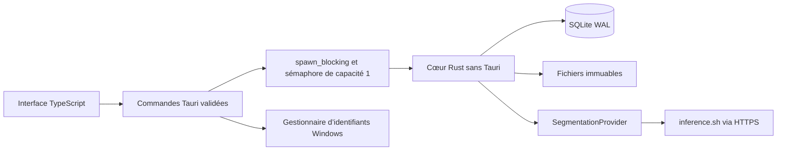

# Architecture · phase 1



## Responsabilités

`model` définit les DTO et valide nombres, catégories et identifiants. `library`
orchestre persistance et transitions. `storage` publie les fichiers sans écrasement.
`imaging` décode, oriente, extrait l’alpha et contrôle le masque. `compose` cadre et
compose sans réseau. `provider` contient un seul vrai connecteur : inference.sh.
Les simulateurs n’existent que dans les tests, jamais dans l’application.

Les commandes reçoivent des UUID, enums et réglages bornés, pas de chemins
arbitraires. Les chemins d’import et d’export proviennent de dialogues natifs ouverts
dans Rust. Aucun plugin shell, HTTP frontend ou accès fichiers générique n’est
autorisé. Le plugin de dialogue est utilisé côté Rust, sans permission IPC accordée.
La CSP n’autorise ni scripts ni contenu distant. Aucune télémétrie.

## Données

Racine : répertoire applicatif local standard, sous-dossier `phototheque`.
Son emplacement réel est affiché dans Paramètres.

```text
studio.sqlite3 (+ éventuels -wal et -shm)
.library.lock                 verrou OS
originals/<SHA256>.<format>    octets d’origine
normalized/<SHA256>.png       copie orientée sans EXIF
previews/<SHA256>.png         miniature maximale 512 × 384
masks/<UUID>-v<N>.png         gris 8 bits
cutouts/<UUID>-v<N>.png       RGB source et alpha du masque
backgrounds/STUDIO_*-v1.png   références 1600 × 1200, SHA256 en base
renders/<clé>.png            compositions
exports/                     réservé ; export vers le dossier choisi
```

Migration `001.sql` transactionnelle, `user_version=1`, refus d’une version inconnue.
Verrou OS pour interdire deux instances sur une photothèque. Connexions courtes,
WAL, clés étrangères et délai d’attente. Les fichiers sont écrits dans un frère
temporaire, synchronisés puis publiés par lien physique sans écrasement. Le stockage
doit supporter ces liens : NTFS local visé. Un crash peut laisser un fichier non
référencé mais ne remplace pas un original. La panne électrique doit encore être
testée sur Windows. Aucun nettoyage automatique n’est fourni.

## Import et fidélité

Le contenu, pas l’extension, détermine JPEG/PNG/WebP. Dimensions vérifiées avant
allocation et décodeur borné. Défaut : 32 Mio / 24 MP, configurables dans les limites
1–64 Mio et 1–40 MP. Les PNG internes ont une limite distincte de 256 Mio / 40 MP
pour normaliser un JPEG compressé. Ce ne sont pas les limites garanties du fournisseur.

EXIF est appliqué à la copie de travail seulement. Les profils ICC intégrés sont
**refusés explicitement** tant qu’un pipeline colorimétrique complet n’est pas
implémenté. Une copie convertie en sRGB sans profil est nécessaire ; retirer un
profil non-sRGB sans conversion n’est pas une solution correcte. Les images animées
ne font pas partie du protocole validé.

Le PNG distant doit avoir une transparence effective et les dimensions orientées
exactes. Le masque vient exclusivement de l’alpha, jamais d’une couleur éliminée.
Les RGB distants sont ignorés ; ceux de la source sont conservés. Aucun traitement
spécifique ne rend les vitres transparentes. Un masque incorrect doit être refusé
par l’utilisateur ; l’éditeur est prévu en phase 3.

Le cadre utilise la boîte englobante de l’alpha non nul et un ratio unique, borné
par les marges et la ligne de sol. Redimensionnement à alpha prémultiplié, dégradés
déterministes versionnés et ombre gaussienne discrète facultative. Aucune génération,
déformation, perspective artificielle ni recréation de véhicule.

## Soumission et reprise

`UNKNOWN` à l’import ; `EXTERIOR` obligatoire pour soumettre ou composer. Les autres
catégories peuvent exporter l’original. Changer de catégorie invalide le rendu.
Le récapitulatif affiche 1 sélection, 0/1 appel, cache, fournisseur/modèle/version et
coût inconnu. Le backend revérifie la version et interdit les doublons. Plafond phase
1 : une soumission par confirmation ; le traitement multi-photo n’est pas encore fourni.

1. Claim SQLite `UPLOADING`, puis import du PNG chez le fournisseur.
2. URI source et `SUBMITTING` enregistrés avant `POST /apps/run`.
3. Identifiant immédiatement conservé, `REMOTE_RUNNING`.
4. Consultations séparées ; jamais de nouvelle soumission automatique.
5. Validation et publication masque/RGBA : `MASK_READY`.
6. Composition locale : `COMPLETED`, validation humaine `NEEDS_REVIEW`.
7. Décision indépendante : `APPROVED` ou `REJECTED`.

Les retries internes de reqwest sont explicitement désactivés. Aucun mécanisme
d’idempotence non documenté n’est inventé. Un refus 4xx reconnu permet une nouvelle
confirmation ; un délai, 5xx ou succès illisible de soumission est ambigu et bloque
la reprise automatique. L’utilisateur retrouve et rattache l’ID dans son compte.
Application, version et URI source sont vérifiées. Sans ID récupérable, le blocage
reste volontaire : aucun bouton « forcer » une facturation potentiellement double.

Au redémarrage, `UPLOADING` est récupérable sans détourage facturé, `SUBMITTING`
devient ambigu et un ID connu reste consultable. L’interface consulte les tâches en
cours toutes les cinq secondes, une à la fois. Les lectures SQLite ne sont pas
bloquées par le sémaphore de travail lourd. Un échec n’interdit pas une autre photo.
L’annulation de file appartient à la phase 2.

## Cache, validation et export

Cache masque : SHA256 source, normalisation v1, fournisseur, modèle,
application/version/fonction épinglées. Une autre version ne constitue pas un hit.
Un ancien masque peut être recomposé explicitement ; changer de modèle ne déclenche
pas d’appel caché.

Cache rendu : source, empreinte/version du masque, version du moteur et du fond,
réglages complets. JPEG/WebP sont encodés à la demande avec la qualité choisie, sans
réutiliser l’encodage d’autres paramètres. `compose` et `export` n’appellent jamais
le fournisseur. Une nouvelle clé de rendu invalide l’approbation. L’interface bloque
l’export de réglages non recomposés.

Un export traité exige `APPROVED` ; l’original est toujours vérifié par SHA256 et
conserve ses octets. Masques/RGBA sont PNG, JPEG/WebP ont les dimensions du rendu.
Noms préfixés, assainis et incrémentés sans écrasement.

## Secrets et réseau

Clé dans Windows Credential Manager (`keyring/windows-native`), jamais dans SQLite,
journaux, exports ou réponse frontend. Les buffers Rust applicatifs sont effacés
par `zeroize` ; cela ne garantit pas l’absence de copies dans la WebView, le réseau
ou Windows. Les erreurs sont assainies : aucun corps distant ni URL signée affiché.

TLS conservé, redirections et retries désactivés. Les transferts sont limités à
`https://cloud.inference.sh:443`, sans userinfo ni fragment. Un autre hôte présigné
reste refusé jusqu’à vérification officielle. Aucune URL libre depuis l’interface,
aucun téléchargement du réseau local. Les exceptions loopback sont sous `cfg(test)`.

## Suite

Phase 2 : imports multiple/dossier/glisser-déposer, véhicules et classement multiple,
file persistante, annulation des tâches non commencées. Phase 3 : éditeur de masque,
fonds personnalisés, photothèque déplaçable, sauvegarde/restauration et exports par
lots approuvés, recette Windows complète. Aucune version serveur n’est développée.
